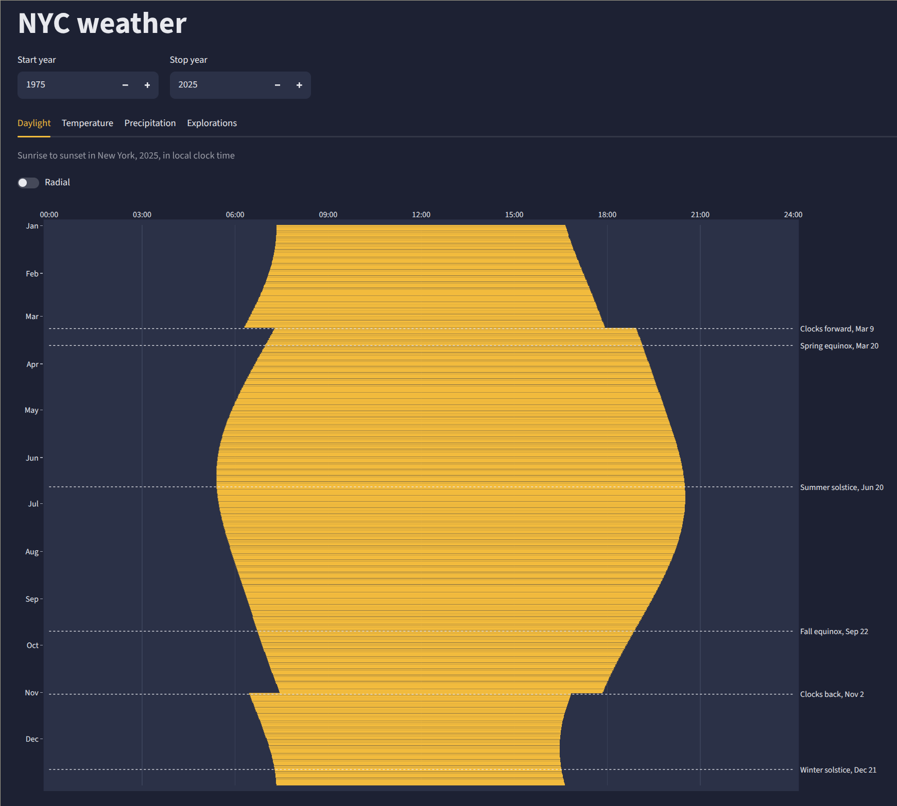
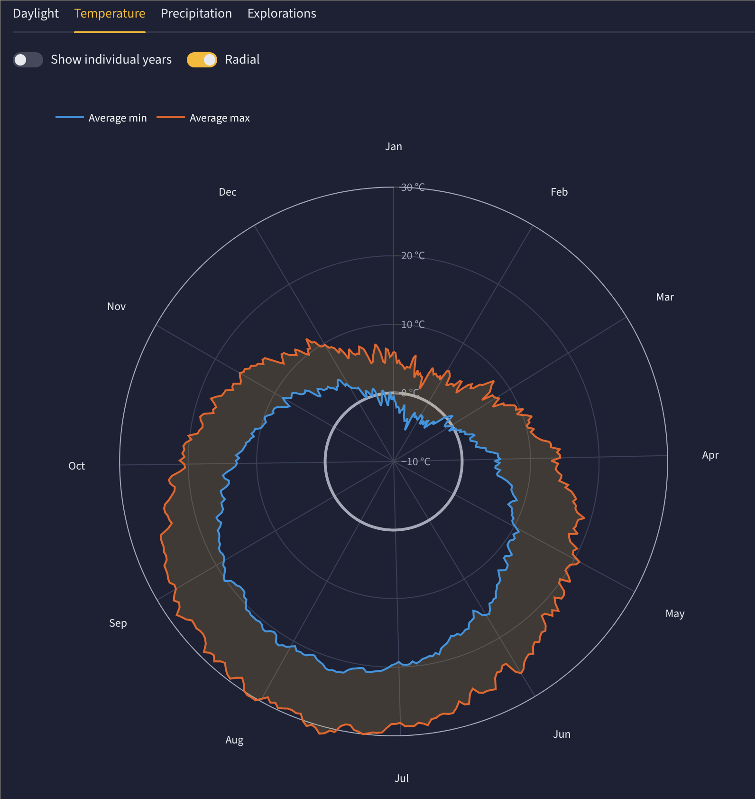
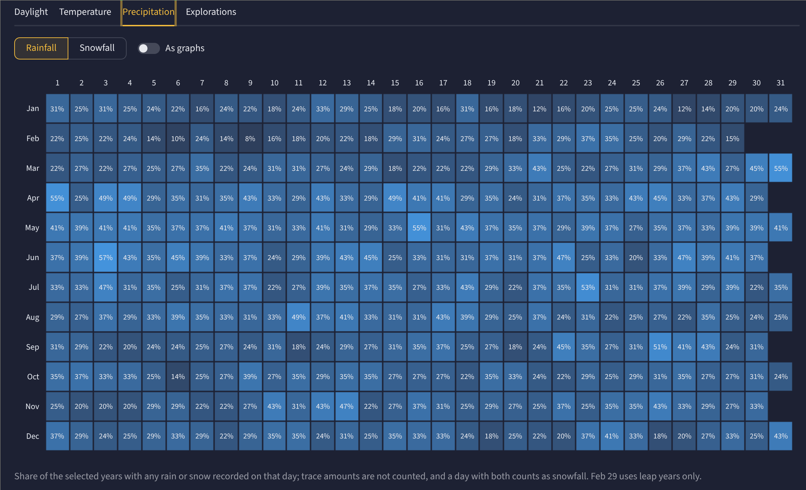

# NYC weather

A Streamlit dashboard of daily weather in New York City (Central Park) from 1975 onward, with tabs for daylight, temperature, precipitation, and explorations.

## Screenshots

**Daylight:** sunrise to sunset in local clock time, with daylight saving changes, equinoxes, and solstices marked.



**Temperature:** average daily minimum and maximum through the year, shown here in the radial view.



**Precipitation:** share of years with rain or snow on each day of the year.



## Usage

```bash
pip install -r requirements.txt
streamlit run
```

The merged data is in the repo, so the dashboard works straight away.

## Updating the data

```bash
python get_weather.py
```

This writes `data/nyc_weather.csv` and `data/nyc_weather_metric.csv`, the latter being what the dashboard reads, as well as `docs/weather.csv` for the static site. Raw downloads go in `data/raw/`, which isn't tracked, and are reused if present, so delete them to get newer data.

## Static site

`docs/` is a Plotly.js translation of the dashboard for GitHub Pages, with no build step: set Pages to serve `/docs` from `main`. To preview it, run `python -m http.server --directory docs`. It's a separate implementation, so a change to `streamlit_app.py` needs making in `docs/figures.js` too. To check that the two still match, run `python docs/compare_figures.py`, which needs Node.

## Data sources

- **Station data:** [NOAA GHCN-Daily](https://www.ncei.noaa.gov/products/land-based-station/global-historical-climatology-network-daily), Central Park station USW00094728 (measured).
- **ERA5 data:** [Open-Meteo archive](https://open-meteo.com/en/docs/historical-weather-api), ERA5 reanalysis (modeled, on a grid of about 25 km).

## AI disclosure

[*Authorship*: 🧠 3%, 🤖 97%](# "Vibecoded based on my prompts and feedback")
